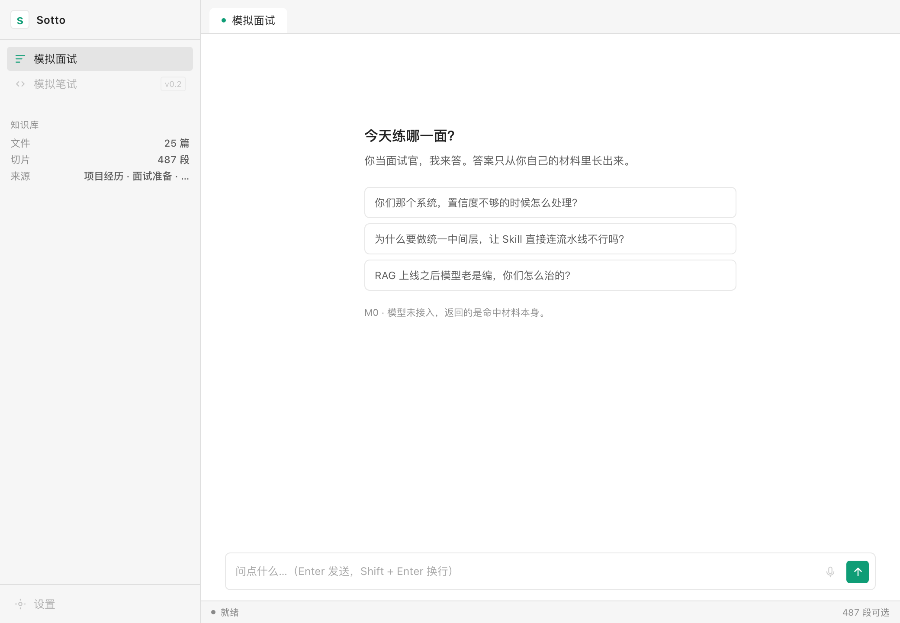
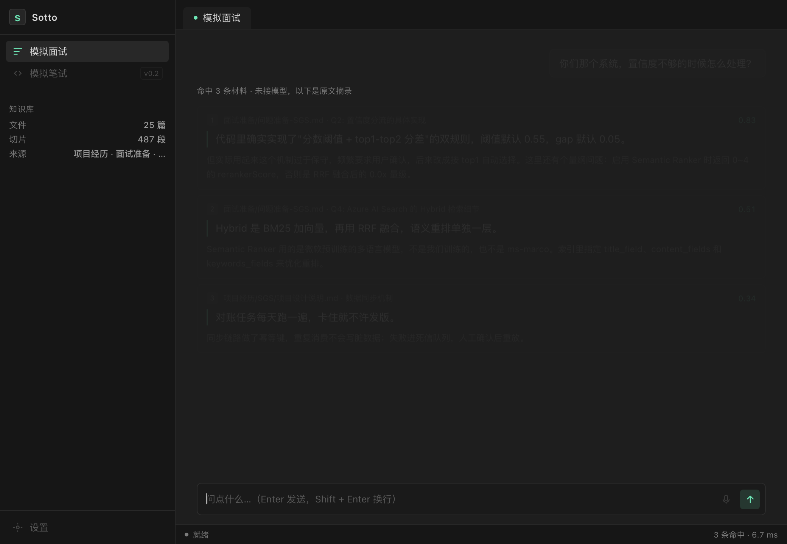

# Sotto

> *The line only you can hear.*
> 私有仓库：https://github.com/Me106y/sotto
> 面试进行中，面试官开口，1.5 秒后你耳朵里响起「你自己」的答案。

这是 PRD（`~/Documents/deepseek-harness/default-workspace/PRD-面试实时助手.md`）的 **M0 实现**。
先做三件能被验证的事，再谈 UI。

---

## 现状

零依赖的 Rust workspace。没有 tokio、没有 reqwest、没有向量库、没有 Tauri —— M0 不该被这些拖住。

```
crates/
  core/     引擎：类型、trait、流水线、打点、延迟预算、mock 适配器
  index/    知识库：作用域扫描 → 问答感知切分 → BM25 + 二元组混合检索 → 实现 core 的 Retriever 端口
  cli/      sotto：scan / chunk / ask / prompt / verify / latency / budget
```

### 哪些是真的

| 部分 | 状态 |
|---|---|
| 作用域扫描（排除 `.qoder` 等生成目录、>512KB 跳过） | ✅ 跑真实笔记 |
| 问答感知切分（`## Qn` 一个问答对一个 chunk） | ✅ |
| BM25 + 字符二元组混合检索 | ✅ 不依赖中文分词 |
| `HybridRetriever` 实现 `core::Retriever` 端口 | ✅ 引擎可直接吃 |
| 管线打点（每阶段耗时 / TTFA / 串行上界） | ✅ |
| 延迟预算 Monte Carlo + 敏感性分析 | ✅ |
| ASR / LLM / TTS | ⚠️ **mock**，只有 sleep 占位 |
| embedding | ⚠️ 未接。v1 用二元组顶着，见「已知问题」 |

**所以下面的数字能证明结构对、检索准、预算算得对；不能证明 1.5 秒能达成。** 那件事要真实 API key。

---

## 桌面 UI（Tauri 2）

界面风格参考 Obsidian：左侧栏 + 标签页 + 状态栏，扁平、低圆角、高密度。窗口默认 1040 × 720。




```bash
cargo run -p sotto-desktop     # 开发模式，直接开窗
```

界面在 `ui/`：纯 HTML/CSS/JS，没有打包器、没有 npm。Tauri 在编译期把整个目录嵌进二进制，
所以 `target/release/sotto-desktop` 是自包含的——拷到别的机器也能跑（前提是语料路径对）。

**当前 UI 有什么**

- 顶栏：产品名 + tagline + 索引状态（几篇 / 几段）
- 两个模式页签：模拟面试（可用）/ 模拟笔试（灰着，标 v0.2）
- 对话流：你的问题 → 命中材料卡片（来源 · 标题 · 相似度 · 首句高亮 · 正文）
- 输入区：Enter 发送 / Shift+Enter 换行；麦克风按钮灰着（M0 未接语音）
- 底栏实时显示「命中几条 · 检索几毫秒」

**它还不是什么**：没有模型生成（返回的是材料本身）、没有语音、没有悬浮条、没有知识库设置页。
这几样按 PRD 的 M1 / M2 顺序补。

### Dock 启动

`~/Applications/Sotto.app` 已经挂到 Dock 上，点一下直接开窗（不是终端）。
它是个极薄的 bundle：`Contents/MacOS/Sotto` 是一个 `exec` 到 `target/release/sotto-desktop`
的脚本，图标在 `Contents/Resources/Sotto.icns`。

丢了或想重装：

```bash
./scripts/install-app.sh           # 只生成 App
./scripts/install-app.sh --dock    # 顺带加进 Dock
```

```bash
# 重新编译后不用动 Dock，脚本每次启动都会找最新的二进制
cargo build --release -p sotto-desktop
```

换图标、改参数、移出 Dock：改 `Contents/Resources/Sotto.icns` / `Contents/MacOS/Sotto`，
或右键图标 → 选项 → 从程序坞中移除。

### 自检

没有截图权限的环境里，用这个确认 UI 真的活了——它会把 DOM 文本、`status`、`search` 的结果写进文件：

```bash
SOTTO_SELFTEST=1 ./target/release/sotto-desktop
# 几秒后
cat /tmp/sotto-selftest.txt
# DOM[s Sotto … 25 篇 · 487 段 …] STATUS[true/487/25] SEARCH[2/5.5ms] TOP[问题准备-SGS.md] LEAD[代码里确实实现了…]
```

### 作用域怎么改

默认读 `~/Desktop/Note`，圈 `项目经历 / 面试准备 / 学习`。用环境变量覆盖：

```bash
SOTTO_ROOT=~/Notes SOTTO_INCLUDE=项目经历,面试准备 cargo run -p sotto-desktop
```

设置页（PRD F6）还没做，M1 再补。

---

## 跑出来的数字（真实语料 `~/Desktop/Note`）

```
作用域（项目经历 + 面试准备 + 学习）：25 篇 / 252.8 KB
chunk：487 个 / 12.3 万字 / 平均 253 字
构成：问答 44 / 小节 439 / 整篇 4
检索：487 个 chunk，3.4 ms / 次
严格召回：12/14 = 86%（要求命中指定文件），命中时平均排名 1.5
延迟预算：P50 1365 ms / P90 1493 ms / 91.2% 落在 1500 ms 内
```

`budget` 的敏感性输出给出一个反直觉的结论：**VAD 尾静音判定（400 ms）是整个预算里第二大项**，
比 ASR + 检索加起来还多。见下面「下一步」。

---

## 命令

```bash
cd ~/Desktop/Sotto
cargo test          # 29 个测试
cargo run -q --bin sotto -- help
```

```bash
# 看作用域：哪些文件会被索引、跳过了什么
cargo run -q --bin sotto -- scan --root ~/Desktop/Note \
  --include 项目经历 --include 面试准备 --include 学习

# 切分质量
cargo run -q --bin sotto -- chunk --root ~/Desktop/Note \
  --include 项目经历 --include 面试准备 --include 学习

# 检索一次
cargo run -q --bin sotto -- ask --root ~/Desktop/Note \
  --include 项目经历 --include 面试准备 \
  "你们那个系统，置信度不够的时候怎么处理？"

# 看真实材料拼出来的 prompt（核对注入质量）
cargo run -q --bin sotto -- prompt --root ~/Desktop/Note \
  --include 项目经历 --include 面试准备 --k 3 \
  "你们那个系统，置信度不够的时候怎么处理？"

# 批量召回验证
cargo run -q --bin sotto -- verify --root ~/Desktop/Note \
  --include 项目经历 --include 面试准备 --include 学习 \
  --file examples/questions.txt

# 管线打点（mock 延迟）
cargo run -q --bin sotto -- latency --trials 5

# 延迟预算与敏感性
cargo run -q --bin sotto -- budget --trials 20000
```

### 问题文件格式

```
问题|||关键词1,关键词2|||期望命中文件的路径片段
```

- 有第三段 → **严格判定**：top-k 里必须出现该文件才算命中；
- 只有前两段 → 宽松判定，容易假阳，**别拿它下结论**。

第一次跑的时候我只写了关键词，结果是「100% 召回」——全是假阳：
「那三层」匹配到了另一篇讲 Memory 的「三层」。加了期望路径之后掉到 86%，这才是真的。

---

## 已知问题（都是真跑出来的，不是猜的）

### 1. BM25 对「换个说法」很脆

问「置信度不够怎么处理」，如果作用域里含 `学习/`，top-1 是讲 RAG 治理的视频笔记，
SGS 那条问答排到第 3。把 `学习/` 去掉，top-1 立刻回到 SGS Q2。

三个原因叠在一起：
- 查询里「知识库问答系统」命中了一堆 RAG 笔记；
- 面试套话「怎么处理」在小语料里 df 很低、idf 却很高（已加查询侧停用词，缓解但没根治）；
- 没有 embedding，就是匹配不到同义改写。

**结论：规模上不需要向量数据库，质量上需要 embedding。** 这两件事我一开始混在一起了。
下一步接本地 bge-small，还是内存暴力算，不引 vector DB。

### 2. `学习/` 会污染「我的项目」类问题

`学习/` 是八股和视频笔记，`项目经历/` 是你的经历。混在一个索引里，
问「你的项目怎么做的」会被八股笔记抢答——而且模型很可能把八股说成「我做过」。

**建议分层召回**：先只查「经历」类，分数不够再查「知识」类。
这也解释了为什么 PRD 里坚持「作用域必须手动圈选」。

### 3. 整篇块的粒度偏大

`*项目经历.md` 走「整篇不切」，实际是 1218~1543 字，是普通 chunk 的 4 倍。
现在在 `Retriever` 端口里把注入截断到 600 字，但索引粒度问题还在。
要么允许整篇按小节切，要么给它单独的权重。

### 4. 一次问答注入 1161 字，答案只有 120 字

上下文/答案比 10:1。延迟上还行（材料都在本地），但会稀释模型的注意力。
下一步考虑：只注入命中段落的前 300 字 + 标题路径。

---

## 接真实供应商要改哪里

四个 trait 在 `crates/core/src/traits.rs`，各写一个实现，引擎一行不用动：

| trait | 建议实现 |
|---|---|
| `Asr` | 火山流式 ASR（WebSocket，增量出字） |
| `Retriever` | 已经接好了：`sotto_index::HybridRetriever` 实现了它 |
| `Llm` | 豆包 / Ark 兼容接口，SSE 流式；每个 delta 丢给 `sink` |
| `Tts` | 火山流式 TTS，**按句送**，不要按字送 |

换掉 mock 后重跑 `latency`，那个数字才是 PRD §6 的验收线。

---

## 下一步（按性价比排）

1. **预测式检索**：把 VAD + ASR + 检索藏到幕后。面试官还在说的时候就用半句去检索，
   末句落定时只跑 LLM + TTS —— 预算从 1365 ms 直接砍到 ~700 ms。
   这是目前最大的一块可省时间，而且不改产品形态。
2. **接 embedding**，解决第 1 条。只用本地模型 + 内存暴力算。
3. **分层召回**，解决第 2 条。
4. 然后再动 UI（Tauri 壳 + 悬浮条）。

---

## 硬规则（写代码时不要破）

1. `crates/core` 里**不许出现** `#[cfg(target_os)]`。平台差异将来只允许出现在 `crates/platform`。
2. 答案全文 ≤ 120 字，第一句必须能直接念出口（`prompt.rs` 的硬约束）。
3. 素材必须有出处。`HitInfo.source` 一路带到 UI，让你一眼看出哪句是真做过的。
4. 不做防检测、不做反录屏伪装。
